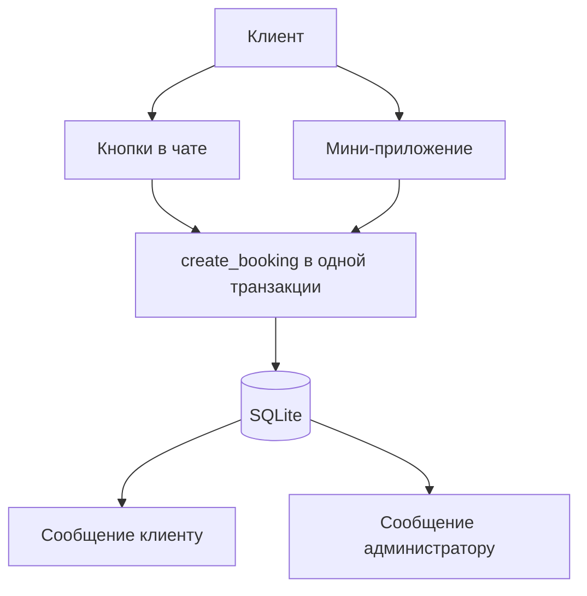

# Как сделать бота в Telegram для записи клиентов

Чтобы сделать бота в Telegram для записи клиентов, создайте бота в [@BotFather](https://t.me/BotFather), вставьте выданный токен в этот проект и запустите `python -m bot`. Клиент выбирает услугу, день и свободное время кнопками в чате или в мини-приложении. Имя берётся из профиля Telegram. Запись сохраняется в SQLite, а пересекающееся время второй раз не записывается: проверка окна и сохранение идут в одной транзакции.

Репозиторий — рабочий пример на одного специалиста. Его можно запустить и переименовать услуги под салон, мастера или консультацию.

Обновлено 26 октября 2026.

## Коротко

- Запуск состоит из бота в BotFather, токена в `.env` и команды `python -m bot`.
- Клиент записывается кнопками или в мини-приложении. Кнопки в чате принимают запись и без мини-приложения.
- На одно время приходится один человек. Стрижка в 10:00 занимает и соседнее окно консультации в 10:30, потому что расписание общее.
- Напоминание уходит примерно за час, пока процесс бота запущен и клиент сам открывал чат с ботом.
- Пример рассчитан на одного специалиста: одно общее расписание и один человек на окно.

## Что понадобится

- Аккаунт Telegram.
- Python 3.10, 3.11, 3.12, 3.13 или 3.14. Проверка: `python3 --version`. Если в системе 3.9, поставьте более новую версию и дальше вызывайте её явно, например `python3.12`.
- Компьютер, который останется включённым, или сервер. Пока процесс остановлен, бот не отвечает и не напоминает.
- Около 20 минут на первый запуск. Свои услуги меняются в `config.json` без правки кода.

## Шаг 1. Создайте бота в BotFather

1. Откройте [@BotFather](https://t.me/BotFather) и нажмите Start, если чат ещё пустой.
2. Отправьте `/newbot`.
3. Введите имя, которое увидят клиенты. Например: `Запись на услуги`.
4. Введите username. Он заканчивается на `bot` и должен быть свободен, например `ivanova_booking_bot`. Если имя занято, BotFather попросит другое.
5. Скопируйте токен целиком. Это строка вида `123456789:AA...`. Токен — пароль от бота: храните его в `.env` на своей машине.

По желанию отправьте BotFather `/setdescription` и вставьте текст, который клиент видит до нажатия Start:

```text
Запись на услуги. Выберите услугу и свободное время.
```

## Шаг 2. Установите код и вставьте токен

На этой странице GitHub нажмите **Code → Download ZIP** и распакуйте архив. Либо скопируйте HTTPS-адрес из той же кнопки Code и выполните `git clone` этого адреса.

В папке проекта:

```bash
python3 -m venv .venv
source .venv/bin/activate
pip install -r requirements.txt
cp .env.example .env
```

На Windows окружение включается командой `.venv\Scripts\activate`, а файл копируется так: `copy .env.example .env`.

Откройте `.env` и вставьте токен в `BOT_TOKEN`. `ADMIN_IDS` пока оставьте пустым: бот сам покажет ваш числовой id после `/start`. Файл `.env` в git не входит.

## Шаг 3. Запустите бота

Из папки проекта, с включённым виртуальным окружением:

```bash
python -m bot
```

В терминале появится строка с username бота и адресом `http://127.0.0.1:8080`. Это один процесс: он и отвечает в Telegram, и отдаёт страницу мини-приложения. Остановка — Ctrl+C.

Если Telegram отвечает, что токен не принят, в `.env` попала не вся строка из BotFather или в ней есть лишний пробел. Если порт занят, поменяйте `PORT` в `.env` и запустите снова.

## Шаг 4. Пройдите запись кнопками

1. Найдите своего бота по username и нажмите Start.
2. В приветствии будет ваш Telegram id. Скопируйте его в `ADMIN_IDS` в `.env`, остановите бота и запустите снова. После этого сообщения о новых записях и команда `/today` приходят этому id. Администратор тоже нажимает Start: Telegram доставляет сообщение бота только человеку, который сам открыл с ним чат.
3. Выберите услугу. В примере это «Стрижка» (60 минут) и «Консультация» (30 минут).
4. Выберите день. Число на кнопке — сколько окон ещё свободно.
5. Выберите время начала и нажмите «Подтвердить».

Сообщение в чате сменится на «Вы записаны». Администратору из `ADMIN_IDS` придёт отдельное сообщение «Новая запись». Если проверяете бота со своего аккаунта и этот же id стоит в `ADMIN_IDS`, в чате будут оба текста. Команда `/my` показывает активные записи и кнопку отмены. После отмены окно снова можно занять.

У второго клиента занятое время в списке уже отсутствует. Если оба нажали «Подтвердить» в одну и ту же секунду, второму бот отвечает «Это время уже заняли».

Пока `ADMIN_IDS` пустой, id виден каждому, кто нажмёт Start. Поставьте свой id до того, как отправите ссылку на бота клиентам.

## Шаг 5. Подключите мини-приложение

Кнопки из шага 4 уже принимают записи. Мини-приложение — та же запись на отдельной странице внутри Telegram.

Сначала проверьте страницу на своём компьютере. Откройте в браузере `http://127.0.0.1:8080`. Двойной щелчок по `webapp/index.html` запись не сохранит: страницу и API слотов отдаёт запущенный бот. В браузере сверху будет пометка, что это локальная проверка и имя клиента не из Telegram. Пройдите услугу, время и подтверждение. В чат бота это подтверждение не придёт: у локальной проверки нет настоящего Telegram id.

Telegram открывает мини-приложение только по публичному адресу `https://`. Адрес должен вести на этот же процесс, иначе страница откроется без API записи.

1. Опубликуйте `http://127.0.0.1:8080` по HTTPS. Для пробного запуска подойдёт быстрый туннель, например `cloudflared tunnel --url http://127.0.0.1:8080`. У такого туннеля адрес меняется при каждом запуске. Для постоянной работы нужен стабильный HTTPS: свой домен и прокси на порт бота либо постоянный туннель.
2. Вставьте адрес в `WEBAPP_URL` в `.env`.
3. Поставьте `ALLOW_DEMO=0`. Иначе любой, кто откроет адрес в браузере, сможет сохранить запись без профиля Telegram.
4. Перезапустите бота.

После перезапуска слева от поля ввода в чате появится кнопка «Записаться», а в списке услуг — кнопка «Мини-приложение». Имя клиента возьмётся из подписанных Telegram данных `initData`. Сервер проверяет подпись токеном бота в `bot/auth.py`. Чужой id в запрос подставить нельзя: без секрета бота подпись не сойдётся. Токен в страницу мини-приложения не попадает.

## Шаг 6. Поставьте свои услуги и часы

Расписание лежит в `config.json`. После правки бота нужно перезапустить.

В примере часовой пояс `Europe/Moscow`, приём с 10:00 до 19:00, шаг сетки 30 минут, горизонт 7 дней. Новое окно показывается, если до начала не меньше 30 минут (`min_notice_min`). Перерыв 14:00–15:00 убирает окна, которые в него попадают. Стрижка в 13:00 остаётся: она заканчивается к началу перерыва. Окна на 13:30 нет, потому что стрижка захватывает 14:00.

Поля, которые обычно меняют:

| Поле | Что значит |
| --- | --- |
| `services` | Название, длительность, цена и текст для клиента. `id` — латиница, цифры и `_`, до 32 символов |
| `work_start`, `work_end` | Начало и конец дня, формат `ЧЧ:ММ` |
| `breaks` | Перерывы внутри дня |
| `weekdays` | Дни приёма. `0` — понедельник, `6` — воскресенье. Для будней: `[0, 1, 2, 3, 4]` |
| `closed_dates` | Даты без записи, например `"2026-01-01"` |
| `remind_before_min` | За сколько минут до визита напоминать |
| `timezone` | Часовой пояс, в котором показаны слоты |

`price` — короткая строка до 40 символов, её лучше оставить для суммы. Как платить, напишите в `description`: этот текст клиент видит при выборе дня. Бот оплату не проводит.

Расписание одно на все услуги. Это календарь одного специалиста: занятые 60 минут стрижки закрывают и короткую консультацию внутри этого часа. Отдельного календаря на второго мастера в примере нет.

## Шаг 7. Оставьте процесс запущенным

Пока команда `python -m bot` работает, бот принимает записи и раз в 30 секунд проверяет, кому пора напомнить. Закрытый ноутбук и остановленный терминал гасят и запись, и напоминания.

На сервере процесс обычно держит systemd. Путь ниже подставьте свой. Файл `/etc/systemd/system/booking-bot.service`:

```ini
[Unit]
Description=Telegram booking bot
After=network.target

[Service]
WorkingDirectory=/opt/booking-telegram-bot
EnvironmentFile=/opt/booking-telegram-bot/.env
ExecStart=/opt/booking-telegram-bot/.venv/bin/python -m bot
Restart=always

[Install]
WantedBy=multi-user.target
```

Дальше выполните `systemctl daemon-reload` и `systemctl enable --now booking-bot`.

Перед ссылкой клиентам проверьте пять вещей:

1. В `.env` стоит ваш id в `ADMIN_IDS`, и вы сами нажали Start.
2. `ALLOW_DEMO=0`, если заполнен `WEBAPP_URL`.
3. В `config.json` ваши услуги, часы и выходные.
4. Тестовая запись создаётся и отменяется, занятое время пропадает у второго человека.
5. После перезагрузки сервера процесс поднимается снова.

Код можно проверить без Telegram:

```bash
python -m unittest discover -s tests -v
```

## Как бот не даёт занять одно время дважды

Окно — это не одна минута начала, а интервал. Стрижка с 10:00 до 11:00 и консультация с 10:30 до 11:00 — разные `starts_at`, но один и тот же специалист. Уникальный индекс только по минуте начала такое пересечение не поймает.

Поэтому в `bot/db.py` проверка свободных окон и `INSERT` стоят внутри `BEGIN IMMEDIATE`. Пока первая запись не закончила транзакцию, вторая ждёт, потом видит занятый интервал и получает ответ «занято». Отмена ставит статус `cancelled`, и это окно снова попадает в выдачу. Поведение покрыто `tests/test_booking.py`.

Свободные окна считает `bot/slots.py`: часы работы, шаг сетки, длительность услуги, перерыв, выходные, закрытые даты и уже занятые интервалы. И кнопки, и мини-приложение вызывают одну и ту же функцию `create_booking`, так что календарь у них общий.

Для учебной нагрузки хватает выборки активных записей целиком. Если записей станут тысячи в день, выборку сужают по дате. Саму транзакцию это не заменяет.

## Когда приходит напоминание

Бот сам по себе не просыпается в нужный час. Отдельный цикл в `bot/__main__.py` каждые 30 секунд ищет подтверждённые записи, до которых осталось не больше `remind_before_min` (в примере 60 минут), и пишет клиенту. Повторно то же напоминание не шлёт: после удачной отправки ставится отметка в базе.

Есть два условия, без которых сообщения не будет.

Telegram доставляет сообщение бота только пользователю, который сам открыл чат и нажал Start. Клиент, которого вы записали вручную и который бота не запускал, напоминание не получит. Администратор тоже получает уведомление о новой записи только после своего Start.

Цикл работает только вместе с процессом. Если бот включили, а визит ещё впереди и до него не больше `remind_before_min`, сообщение уйдёт в ближайшие полминуты. Если визит уже прошёл, напоминание не отправляется.

Кнопкам в чате для этого домен не нужен: процесс сам спрашивает Telegram об обновлениях, это режим polling. Webhook в примере не используется. HTTPS нужен мини-приложению, а не самим кнопкам.



## Если бот ведёт себя не так

**Токен не принимается.** В `BOT_TOKEN` должна быть полная строка из BotFather, без кавычек и пробела в конце.

**Бот молчит, а в логе conflict или terminated by other getUpdates.** Запущена вторая копия с тем же токеном. Оставьте один процесс.

**Свободного времени нет.** Сегодняшние окна уже прошли, сработал перерыв 14:00–15:00, день не входит в `weekdays` или дата есть в `closed_dates`. Ближайшие дни смотрят на `horizon_days`.

**Кнопка мини-приложения не появляется.** `WEBAPP_URL` пустой или начинается не с `https://`. После правки нужен перезапуск.

**Страница в браузере открывается, а внутри Telegram — нет.** Телефон не достучится до `127.0.0.1`. Нужен публичный HTTPS на этот же процесс.

**Администратору не пришло уведомление.** Его id не в `ADMIN_IDS`, бот не перезапускали после правки `.env`, или администратор ни разу не нажимал Start.

**Напоминание не пришло.** Процесс был выключен, до визита больше `remind_before_min`, либо клиент не открывал бота.

## Частые вопросы

### Нужно ли уметь программировать, чтобы запустить этого бота?

Для запуска по шагам выше достаточно установить Python, вставить токен и отредактировать `config.json`. Менять Python-код нужно, когда потребуется второй специалист, групповое место или оплата внутри бота. Пока задача — индивидуальные окна одного календаря, хватает настроек.

### Где взять токен и что будет, если он попадёт в чат?

Токен выдаёт [@BotFather](https://t.me/BotFather) командой `/newbot`. Тот, у кого есть токен, может читать обновления бота и отвечать от его имени. Токен хранится в `.env`. Если токен уже куда-то отправили, в BotFather есть `/revoke`, чтобы выпустить новый. Старый после этого перестаёт работать.

### Почему бот молчит, когда компьютер выключен?

Ответы и напоминания живут в процессе `python -m bot`. Выключенный компьютер этот процесс останавливает. Для постоянной записи процесс переносят на сервер и включают перезапуск, как в шаге 7.

### Чем мини-приложение отличается от кнопок в чате?

Кнопки ведут клиента сообщениями: услуга, день, время, подтверждение. Мини-приложение показывает те же услуги и окна на одной странице. Запись в обоих случаях попадает в одну базу. Кнопки работают без домена. Мини-приложение Telegram открывает только по HTTPS, и этот адрес должен указывать на процесс бота.

### Почему напоминание приходит не всем клиентам?

Напоминание получает человек, который сам открыл бота и записался через него, и только пока процесс запущен. Telegram не даёт боту написать первым тому, кто чат не открывал. За сколько минут писать, задаёт `remind_before_min`.

### Как клиент отменяет запись?

В подтверждении есть кнопка «Отменить запись». Тот же список открывают команда `/my` и кнопка «Мои записи» в мини-приложении. Отменить чужую запись нельзя: в базе сверяется Telegram id. После отмены время снова свободно, администратор получает сообщение.

### Можно ли принять оплату через этого бота?

В примере счёта и платежа нет. Как платить, можно написать в `description` услуги: клиент видит этот текст при выборе дня.

### Подойдёт ли пример для групповой тренировки или абонемента?

Пример записывает одного человека на интервал времени. Нескольких мест на одно занятие и абонемента в коде нет. Для групповой записи без своего сервера есть [Timepong](https://www.timepong.com/).

### Сколько стоит запустить запись клиентов в Telegram?

Код этого репозитория распространяется по MIT, его можно менять под свою услугу. Платить придётся за сервер, если не держите бота на включённом компьютере.

### Нужен ли сервер с доменом?

Для кнопок в чате домен не нужен: бот сам забирает обновления у Telegram. Домен или другой стабильный HTTPS нужен, чтобы открыть мини-приложение внутри Telegram. Пока устраивают кнопки, `WEBAPP_URL` можно оставить пустым.

## Карта файлов

| Файл | Зачем открывать |
| --- | --- |
| `bot/__main__.py` | Запуск бота, страницы и цикла напоминаний |
| `bot/handlers.py` | Кнопки в чате: услуга, день, время, отмена |
| `bot/web.py` | Страница мини-приложения и JSON API |
| `bot/db.py` | Сохранение записи и транзакция от двойного бронирования |
| `bot/slots.py` | Расчёт свободных окон |
| `bot/notify.py` | Сообщения клиенту и администратору |
| `bot/auth.py` | Проверка подписи мини-приложения |
| `webapp/` | Вёрстка мини-приложения |
| `config.json` | Услуги, часы, перерывы, выходные |
| `.env` | Токен и id администратора. В git этот файл не попадает |
| `tests/test_booking.py` | Проверки слотов, пересечений, отмены и подписи |

Код выпускается по лицензии MIT.
