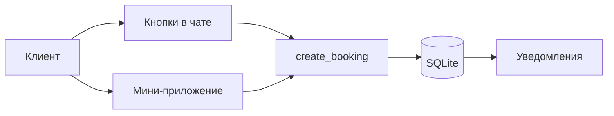

# Как сделать бота в Telegram для записи клиентов

Бот с открытым кодом для записи клиентов в Telegram: кнопки в чате, мини-приложение, напоминания и защита от двойного бронирования. Создайте бота в [@BotFather](https://t.me/BotFather), вставьте токен в `.env` и запустите `python -m bot`. Первая запись займёт около 20 минут.

**Что умеет бот**

- **Запись без переписки.** Клиент выбирает услугу, день и время кнопками в чате или в мини-приложении. Имя подставляется из профиля Telegram.
- **Без двойного бронирования.** Проверка окна и сохранение записи идут в одной транзакции SQLite. Пересекающееся время второй раз не записывается.
- **Уведомления.** Клиент получает подтверждение и напоминание, администратор — сообщение о каждой новой записи и отмене.
- **Настройка без кода.** Услуги, часы работы, перерывы и выходные задаются в `config.json`.

> [!NOTE]
> Пример рассчитан на одного специалиста: одно расписание на все услуги и один клиент на интервал времени.

## Содержание

- [Быстрый старт](#быстрый-старт)
- [Мини-приложение](#мини-приложение)
- [Настройка расписания](#настройка-расписания)
- [Развёртывание на сервере](#развёртывание-на-сервере)
- [Как это устроено](#как-это-устроено)
- [Справочник](#справочник)
- [Устранение неполадок](#устранение-неполадок)
- [Частые вопросы](#частые-вопросы)

## Быстрый старт

### Требования

- Аккаунт Telegram
- Python 3.10–3.14. Версию покажет `python3 --version`.
- Компьютер или сервер, на котором процесс будет работать постоянно

### 1. Создайте бота

1. Откройте [@BotFather](https://t.me/BotFather) и отправьте `/newbot`.
2. Введите имя, которое увидят клиенты, например `Запись на услуги`.
3. Введите username, который заканчивается на `bot`, например `ivanova_booking_bot`.
4. Скопируйте токен вида `123456789:AA...`.

> [!WARNING]
> С токеном можно управлять ботом от вашего имени. Храните его только в `.env`. Если токен утёк, выпустите новый командой `/revoke` в BotFather.

### 2. Установите зависимости

```bash
git clone https://github.com/dmitryrodnikov/telegram-bot-zapis-klientov.git
cd telegram-bot-zapis-klientov
python3 -m venv .venv
source .venv/bin/activate
pip install -r requirements.txt
cp .env.example .env
```

На Windows окружение включается командой `.venv\Scripts\activate`, а `.env` создаётся командой `copy .env.example .env`.

### 3. Добавьте токен

Откройте `.env` и вставьте токен:

```bash
BOT_TOKEN=123456789:AA...
```

### 4. Запустите бота

```bash
python -m bot
```

```text
2026-10-27 10:00:00,000 INFO booking: Бот @ivanova_booking_bot запущен. Мини-приложение в браузере: http://127.0.0.1:8080
```

Один процесс отвечает в Telegram и отдаёт мини-приложение. Остановить его можно сочетанием Ctrl+C.

### 5. Назначьте администратора

1. Откройте бота в Telegram и нажмите **Start**. В приветствии будет ваш Telegram id.
2. Добавьте id в `.env`: `ADMIN_IDS=123456789`.
3. Перезапустите бота.

Теперь сообщения о новых записях приходят вам, а команда `/today` показывает расписание на день.

> [!IMPORTANT]
> Пока `ADMIN_IDS` пуст, бот показывает id каждому, кто нажмёт Start. Заполните поле до того, как отправлять ссылку клиентам.

### 6. Проверьте запись

Выберите услугу, день и время, затем нажмите **Подтвердить**. Бот ответит «Вы записаны» и пришлёт администратору «Новая запись». Записи клиента и кнопку отмены показывает `/my`.

## Мини-приложение

Мини-приложение — та же запись в виде страницы внутри Telegram. Кнопки в чате работают и без него.

### Локальная проверка

Откройте `http://127.0.0.1:8080` в браузере. Когда `ALLOW_DEMO=1`, страница принимает записи без Telegram и показывает пометку о тестовом режиме.

### Подключение к Telegram

Telegram открывает мини-приложения только по публичному HTTPS-адресу, который ведёт на этот же процесс.

1. Опубликуйте локальный порт по HTTPS. Для пробы подойдёт временный туннель:

   ```bash
   cloudflared tunnel --url http://127.0.0.1:8080
   ```

   Адрес временного туннеля меняется при каждом запуске. Для постоянной работы нужен домен с HTTPS.

2. Обновите `.env`:

   ```bash
   WEBAPP_URL=https://booking.example.com
   ALLOW_DEMO=0
   ```

3. Перезапустите бота.

Рядом с полем ввода появится кнопка **Записаться**, а в меню услуг — **Мини-приложение**.

> [!WARNING]
> Выключите `ALLOW_DEMO` перед публикацией адреса. Иначе записи без профиля Telegram сможет создавать любой, кто откроет страницу.

Сервер определяет клиента по подписанным данным `initData` и проверяет подпись токеном бота. Подменить Telegram id в запросе нельзя, а сам токен на страницу не передаётся.

## Настройка расписания

Расписание хранится в `config.json`. Изменения применяются после перезапуска.

```json
{
  "timezone": "Europe/Moscow",
  "work_start": "10:00",
  "work_end": "19:00",
  "step_min": 30,
  "breaks": [{ "start": "14:00", "end": "15:00" }],
  "services": [
    {
      "id": "haircut",
      "title": "Стрижка",
      "duration_min": 60,
      "price": "2000 ₽",
      "description": "Индивидуальный приём одного человека"
    }
  ]
}
```

С такими настройками стрижку можно начать в 13:00, но не в 13:30: в этом случае она заходит на перерыв.

Все поля описаны в [справочнике `config.json`](#configjson).

> [!TIP]
> Бот не принимает оплату. Способ оплаты укажите в `description`: клиент увидит этот текст при выборе дня.

## Развёртывание на сервере

Бот принимает записи и отправляет напоминания, только пока запущен процесс. Для постоянной работы запустите его как службу systemd.

Создайте `/etc/systemd/system/booking-bot.service` со своим путём к проекту:

```ini
[Unit]
Description=Telegram booking bot
After=network.target

[Service]
WorkingDirectory=/opt/booking-telegram-bot
EnvironmentFile=/opt/booking-telegram-bot/.env
ExecStart=/opt/booking-telegram-bot/.venv/bin/python -m bot
Restart=always

[Install]
WantedBy=multi-user.target
```

```bash
sudo systemctl daemon-reload
sudo systemctl enable --now booking-bot
```

### Перед запуском для клиентов

- [ ] Ваш id добавлен в `ADMIN_IDS`, и вы нажали Start в боте.
- [ ] `ALLOW_DEMO=0`, если заполнен `WEBAPP_URL`.
- [ ] Услуги, часы и выходные в `config.json` соответствуют реальному расписанию.
- [ ] Тестовая запись создаётся и отменяется.
- [ ] Бот запускается сам после перезагрузки сервера.

## Как это устроено



### Свободные окна

`bot/slots.py` строит сетку с шагом `step_min` и убирает окна, которые:

- выходят за часы работы;
- пересекают перерыв или существующую запись;
- начинаются раньше, чем через `min_notice_min` минут;
- приходятся на выходной или закрытую дату.

### Защита от двойного бронирования

Запись — это интервал, а не время начала. Стрижка с 10:00 до 11:00 и консультация с 10:30 до 11:00 начинаются в разное время, но пересекаются, поэтому уникальный индекс по `starts_at` не помогает.

`create_booking` в `bot/db.py` проверяет окно и вставляет запись внутри `BEGIN IMMEDIATE`. Второй параллельный запрос ждёт окончания первой транзакции, видит занятый интервал и получает ответ `taken`. Кнопки и мини-приложение используют одну функцию и одно расписание.

### Напоминания

Фоновый цикл раз в 30 секунд ищет записи, до начала которых осталось не больше `remind_before_min` минут, и отправляет напоминание. Каждое напоминание уходит один раз.

> [!NOTE]
> Telegram не позволяет боту написать первым. Напоминания и уведомления получают только пользователи, которые нажали Start в этом боте.

### Получение обновлений

Бот работает в режиме long polling и сам запрашивает обновления у Telegram, поэтому кнопкам в чате не нужен домен. HTTPS требуется только для мини-приложения.

## Справочник

### Переменные окружения

| Переменная | По умолчанию | Описание |
| --- | --- | --- |
| `BOT_TOKEN` | — | Токен из BotFather. Обязательна. |
| `ADMIN_IDS` | — | Telegram id администраторов через запятую |
| `WEBAPP_URL` | — | Публичный HTTPS-адрес мини-приложения |
| `ALLOW_DEMO` | `0` | `1` разрешает записи из браузера без Telegram. В `.env.example` включена для локальной проверки. |
| `HOST` | `127.0.0.1` | Адрес HTTP-сервера |
| `PORT` | `8080` | Порт HTTP-сервера |
| `DB_PATH` | `data/bookings.sqlite` | Путь к базе SQLite |
| `CONFIG_PATH` | `config.json` | Путь к файлу расписания |

### `config.json`

| Поле | По умолчанию | Описание |
| --- | --- | --- |
| `timezone` | `Europe/Moscow` | Часовой пояс расписания в формате IANA |
| `work_start`, `work_end` | — | Начало и конец рабочего дня, `ЧЧ:ММ` |
| `step_min` | `30` | Шаг сетки в минутах, 5–240 |
| `horizon_days` | `7` | На сколько дней вперёд открыта запись, 1–60 |
| `min_notice_min` | `30` | Минимальное время до начала записи в минутах |
| `remind_before_min` | `60` | За сколько минут до начала отправлять напоминание |
| `weekdays` | все дни | Рабочие дни: `0` — понедельник, `6` — воскресенье |
| `closed_dates` | `[]` | Нерабочие даты в формате `ГГГГ-ММ-ДД` |
| `breaks` | `[]` | Перерывы: `{ "start": "14:00", "end": "15:00" }` |
| `services` | — | Список услуг, минимум одна |

Поля услуги:

| Поле | Описание |
| --- | --- |
| `id` | Латиница, цифры и `_`, до 32 символов |
| `title` | Название, до 40 символов |
| `duration_min` | Длительность в минутах, 5–720 |
| `price` | Цена для показа, до 40 символов |
| `description` | Описание для клиента, до 300 символов |

### Команды бота

| Команда | Кто может вызвать | Описание |
| --- | --- | --- |
| `/start` | Все | Список услуг и запись |
| `/my` | Все | Активные записи и отмена |
| `/today` | Администраторы | Записи на сегодня |

### HTTP API

API используется мини-приложением. Запросы, которые создают, показывают или отменяют записи клиента, принимают `init_data` из `Telegram.WebApp.initData`.

| Метод | Путь | Описание |
| --- | --- | --- |
| `GET` | `/api/services` | Список услуг |
| `GET` | `/api/days?service_id=` | Дни со свободными окнами |
| `GET` | `/api/slots?service_id=&day=` | Свободные окна на день |
| `POST` | `/api/book` | Создать запись: `service_id`, `starts_at`, `init_data` |
| `POST` | `/api/my` | Записи клиента: `init_data` |
| `POST` | `/api/cancel` | Отменить запись: `id`, `init_data` |
| `GET` | `/health` | Проверка доступности |

Коды ошибок: `400` — некорректный запрос, `401` — неверная подпись `init_data`, `404` — услуга или запись не найдена, `409` — время уже занято.

### Структура проекта

```text
bot/
  __main__.py   запуск бота, HTTP-сервера и напоминаний
  handlers.py   сценарий записи кнопками
  web.py        мини-приложение и HTTP API
  db.py         хранение записей и транзакция бронирования
  slots.py      расчёт свободных окон
  auth.py       проверка подписи initData
  notify.py     сообщения клиенту и администратору
webapp/         интерфейс мини-приложения
tests/          тесты
config.json     услуги и расписание
```

### Тесты

```bash
python -m unittest discover -s tests -v
```

## Устранение неполадок

| Симптом | Причина и решение |
| --- | --- |
| Telegram не принимает токен | Проверьте, что `BOT_TOKEN` скопирован целиком, без кавычек и пробелов. |
| В логе `Conflict: terminated by other getUpdates` | С этим токеном запущена вторая копия бота. Остановите лишний процесс. |
| Нет свободного времени | Проверьте `work_start`, `work_end`, `breaks`, `weekdays`, `closed_dates` и `horizon_days`. |
| Нет кнопки мини-приложения | `WEBAPP_URL` пуст или не начинается с `https://`. После правки перезапустите бота. |
| Мини-приложение не открывается в Telegram | Адрес `127.0.0.1` доступен только на вашем компьютере. Нужен публичный HTTPS. |
| Администратор не получает уведомления | Проверьте `ADMIN_IDS`, перезапустите бота и нажмите Start с аккаунта администратора. |
| Напоминание не пришло | Бот был остановлен, клиент не нажимал Start или до записи больше `remind_before_min`. |
| Порт уже занят | Измените `PORT` в `.env`. |

## Частые вопросы

### Нужно ли уметь программировать?

Нет. Для запуска достаточно установить Python, вставить токен и отредактировать `config.json`. Код понадобится менять, если нужно добавить второго специалиста, групповые места или онлайн-оплату.

### Нужен ли сервер с доменом?

Для кнопок в чате — нет: бот сам получает обновления у Telegram. Домен с HTTPS нужен только для мини-приложения.

### Как клиент отменяет запись?

Кнопкой «Отменить запись» в подтверждении, через `/my` или в разделе «Мои записи» мини-приложения. Отменить чужую запись нельзя.

### Почему напоминания получают не все клиенты?

Telegram доставляет сообщения бота только пользователям, которые сами нажали Start. Клиент, записанный вручную, напоминание не получит.

### Можно ли принимать оплату?

Встроенной оплаты нет. Укажите способ оплаты в `description` услуги.

### Подходит ли бот для групповых занятий и абонементов?

Нет. Пример записывает одного клиента на интервал времени. Для групповой записи без своего сервера есть готовые сервисы, например [Timepong](https://www.timepong.com/).

### Сколько стоит запуск?

Код распространяется бесплатно по лицензии MIT. Если бот работает не на вашем компьютере, придётся платить только за сервер.

## Лицензия

[MIT](LICENSE)
